# RV32I RISC-V Single-Cycle Processor: Complete RTL-to-GDSII ASIC Flow

[](https://riscv.org/)
[](https://github.com/google/skywater-pdk)
[-green?style=flat-square)](https://github.com/The-OpenROAD-Project/OpenLane)
[-brightgreen?style=flat-square)]()
[-success?style=flat-square)]()
[]()
[](results/riscv_core.gds)

An open-source, synthesizable 32-bit single-cycle RISC-V processor (RV32I Base Integer ISA) built from scratch in Verilog HDL, functionally verified with automated regression test suites, timing-closed at 50 MHz, and physically implemented to tapeout-ready GDSII silicon layout using the SkyWater 130nm High-Density PDK (`sky130_fd_sc_hd`).

---

## 📸 Silicon Preview & Physical Layout

The tapeout-ready GDSII stream (`results/riscv_core.gds`) was synthesized, placed, and routed via OpenLane 2 and visualized in **KLayout**:

<p align="center">
  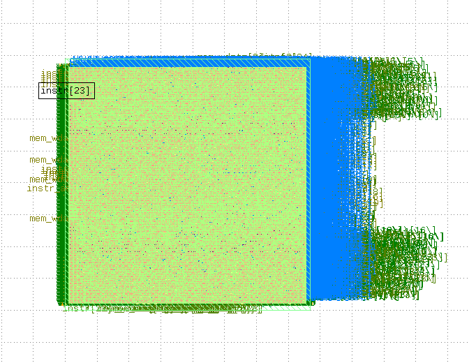
  <br/>
  <em><b>Figure 1:</b> Tapeout-ready GDSII Silicon Die (280 µm × 280 µm) showing power distribution ring, 5-metal interconnect stack, and 4,551 placed standard cells.</em>
</p>

<p align="center">
  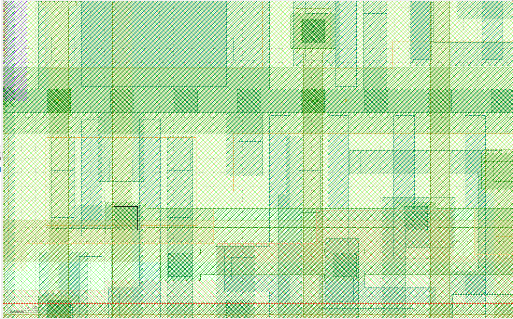
  <br/>
  <em><b>Figure 2:</b> Microscopic view in KLayout detailing physical CMOS transistor polysilicon gates, source/drain diffusions, contact vias, and local Metal 1/2 routing.</em>
</p>

---

## ⚡ Key Silicon & Implementation Metrics

| Parameter / Metric | Specification | Achieved Silicon Result | Status |
|:---|:---|:---|:---:|
| **Architecture** | RISC-V RV32I Base Integer ISA | Single-Cycle Datapath ($CPI = 1.0$) | **Verified** |
| **Process Node** | SkyWater 130nm CMOS | `sky130_fd_sc_hd` (High-Density) | **Production PDK** |
| **Die Dimensions** | $< 300\text{ µm} \times 300\text{ µm}$ | **280 µm × 280 µm** ($78,400\text{ µm}^2$) | **Target Met** |
| **Standard Cell Count** | N/A | **4,551 physical cells** ($58,134.5\text{ µm}^2$) | **Optimal** |
| **Target Clock Frequency** | 50.0 MHz ($T_{clk} = 20.0\text{ ns}$) | **50.0 MHz** | **Timing Closed** |
| **Worst Setup Slack** | $\ge 0.00\text{ ns}$ | **+2.68 ns (MET)** | **Margin Achieved** |
| **Total Negative Slack (TNS)**| $0.00\text{ ns}$ | **0.00 ns** | **Zero Violations** |
| **Design Rule Check (DRC)**| 0 errors | **0 Magic / KLayout DRC errors** | **DRC Clean** |
| **Layout Vs Schematic (LVS)**| 0 unmatched nets | **0 net / pin discrepancies** | **LVS Clean** |
| **Physical Signoff Output** | GDSII Stream File | [`results/riscv_core.gds`](results/riscv_core.gds) | **Committed** |

---

## 🏛️ Microarchitecture & Single-Cycle Datapath

The core implements a strict Harvard architecture with a single-cycle execution model where every instruction completes within one clock period:

<p align="center">
  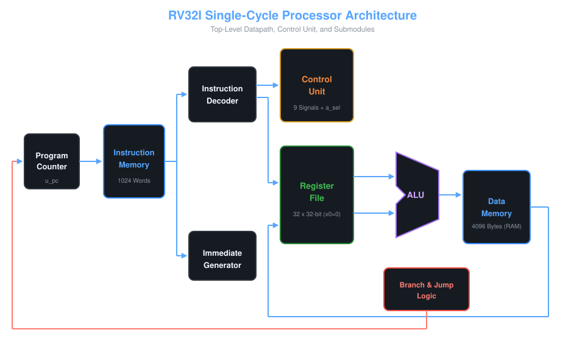
  <br/>
  <em><b>Figure 3:</b> Single-Cycle Datapath Architecture Diagram integrating Control Unit, Register Bank, ALU, Memories, and Multiplexers.</em>
</p>

### Microarchitectural Highlights:
- **32-Bit Register File (`register_file.v`):** 32 general-purpose 32-bit registers. Features simultaneous dual combinational read ports and one synchronous write port. Register `x0` is physically hardwired to zero on both reads and writes.
- **Arithmetic Logic Unit (`alu.v`):** 10 operations (ADD, SUB, AND, OR, XOR, SLL, SRL, SRA, SLT, SLTU) with dedicated zero-flag output for branch resolution.
- **Central Control Unit (`control_unit.v`):** Pure combinational decoder outputting 10 control strobes, including `a_sel[1:0]` for AUIPC (PC + imm) and LUI (0 + imm).
- **Branch & Jump Logic (`branch_jump_logic.v`):** In-cycle condition testing for all 6 branch types (BEQ, BNE, BLT, BGE, BLTU, BGEU) and target address computation for JAL and JALR (with bit 0 masked per specification).
- **Harvard Memory Model:**
  - **Instruction Memory (`instr_mem.v`):** 1024-word (4 KB) combinational ROM initialized via `$readmemh`.
  - **Data Memory (`data_mem.v`):** 4096-byte (4 KB) Little-Endian synchronous RAM supporting byte (`lb`/`lbu`/`sb`), halfword (`lh`/`lhu`/`sh`), and word (`lw`/`sw`) transactions with sign/zero extension.
- **Reset Safety Interlock:** `safe_reg_write` and `safe_mem_write` are gated with `~rst` to prevent state corruption during startup.

---

## 🧪 Verification & Simulation Results

### 1. Master Regression Suite (33/33 Tests Passed)
The processor was verified using autonomous, self-checking assembly testbenches compiled into hexadecimal firmware files:

| Test Suite | Target Instructions | Architectural Behavior Verified | Result |
|:---|:---|:---|:---:|
| `test_addsub.hex` | `addi`, `add`, `sub` | Arithmetic datapath, negative numbers, register writeback | **PASS (5/5)** |
| `test_logic.hex` | `and`, `or`, `xor`, `sll`, `srl`, `sra` | Bitwise masks, barrel shifter, arithmetic sign preservation | **PASS (11/11)** |
| `test_upper.hex` | `lui`, `auipc` | 32-bit constant construction, PC-relative addressing | **PASS (3/3)** |
| `test_mem.hex` | `sw`, `lw`, `sb`, `lb`, `lbu` | Little-Endian RAM access, signed and unsigned byte load | **PASS (6/6)** |
| `test_branch.hex` | `beq`, `bne` | 5-iteration countdown loop, forward branch skipping | **PASS (5/5)** |
| `test_jal.hex` | `jal`, `jalr` | Subroutine call, return via link register `ra` (x1) | **PASS (3/3)** |

**Total Regression Checks: 33 / 33 Verified Passing (100% Pass Rate).**

### 2. Full CPU Cycle-Accurate Waveform
Captured in **GTKWave**, the trace below demonstrates sequential instruction execution, program counter transitions, ALU computation, and register writeback:

<p align="center">
  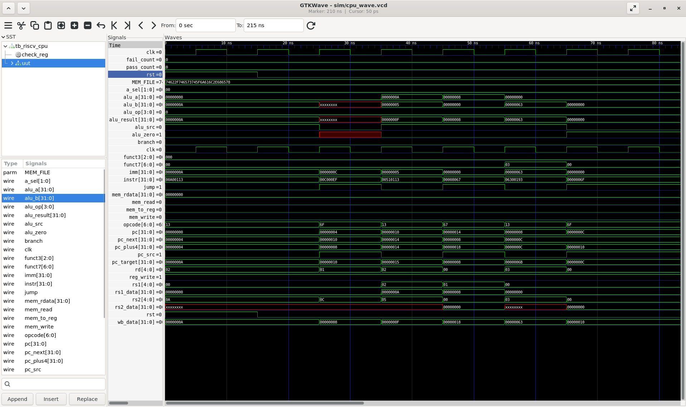
  <br/>
  <em><b>Figure 4:</b> GTKWave simulation trace for tb_riscv_cpu proving pass_count = 3, fail_count = 0, and continuous execution.</em>
</p>

### 3. Post-Synthesis Gate-Level Simulation (GLS)
The gate netlist synthesized with SkyWater 130nm cells was simulated with physical gate delays in Icarus Verilog to confirm functional equivalence:

<p align="center">
  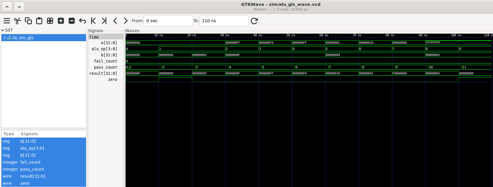
  <br/>
  <em><b>Figure 5:</b> Post-synthesis Gate-Level Simulation (GLS) in GTKWave confirming 11/11 tests passing on physical Sky130 standard cells.</em>
</p>

### 4. Unit-Level Hardware Verification Gallery
<details>
  <summary><b>🔍 Click to Expand: Individual Module GTKWave Simulation Waveforms</b></summary>
  <br/>

  <h4>A. Register File (Dual Asynchronous Read & Synchronous Write)</h4>
  <p align="center">
    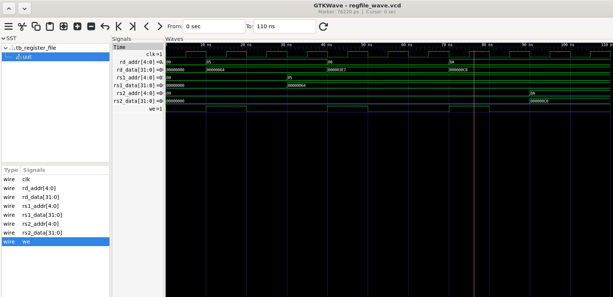
    <br/>
    <em>Verification of dual simultaneous reads (x5, x10) and hardware protection of register x0 (writes to x0 strictly ignored).</em>
  </p>

  <h4>B. 10-Operation Arithmetic Logic Unit (ALU)</h4>
  <p align="center">
    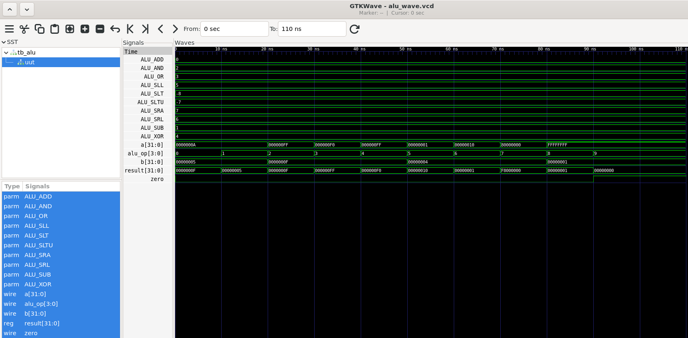
    <br/>
    <em>Verification of all 10 operations (ADD, SUB, AND, OR, XOR, SLL, SRL, SRA, SLT, SLTU) and zero flag assertion.</em>
  </p>

  <h4>C. Central Control Unit Decoding</h4>
  <p align="center">
    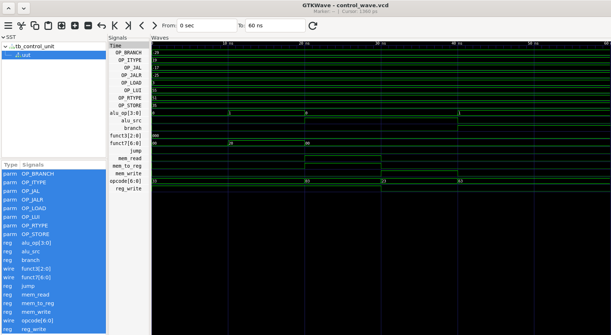
    <br/>
    <em>Instantaneous combinational generation of control signals (reg_write, alu_src, mem_read, mem_write, a_sel) across opcodes.</em>
  </p>

  <h4>D. Branch & Jump Target Logic</h4>
  <p align="center">
    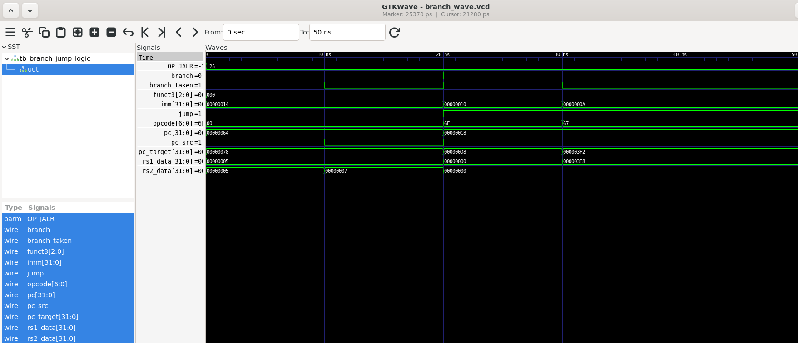
    <br/>
    <em>Condition evaluation for BEQ, BNE, BLT, BGE, BLTU, BGEU and target arithmetic for JAL / JALR.</em>
  </p>

  <h4>E. 4KB Little-Endian Data RAM Subsystem</h4>
  <p align="center">
    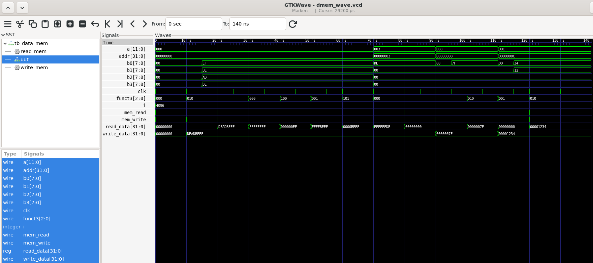
    <br/>
    <em>Validation of byte-lane storage (0xDEADBEEF), byte/halfword masking, and signed (LB) vs unsigned (LBU) memory reads.</em>
  </p>
</details>

---

## ⚙️ ASIC Implementation Flow (RTL-to-GDSII)

The physical design flow was automated headlessly using **OpenLane 2** via GitHub Actions:

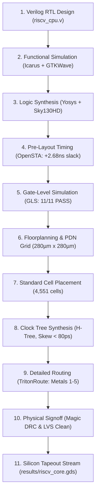

---

## 📂 Repository Directory Structure

```text
riscv-rtl-to-gds/
├── rtl/                          # Synthesizable Verilog HDL Source Files
│   ├── alu.v                     # 10-Operation Arithmetic Logic Unit
│   ├── branch_jump_logic.v       # Branch condition comparator & target logic
│   ├── control_unit.v            # Central single-cycle control decoder
│   ├── data_mem.v                # 4KB Little-Endian synchronous RAM
│   ├── imm_gen.v                 # Immediate sign-extension & bit-splicer
│   ├── instr_decoder.v           # Structural instruction bit-slicer
│   ├── instr_mem.v               # 1024-Word combinational ROM ($readmemh)
│   ├── program_counter.v         # 32-bit PC register with async reset
│   ├── register_file.v           # 32x32-bit register file (x0 protected)
│   ├── riscv_core.v              # Core wrapper for physical design
│   └── riscv_cpu.v               # Top-level datapath & multiplexer glue
├── tb/                           # Unit & System-Level Testbenches
│   ├── tb_alu.v / tb_alu_gls.v   # RTL and Gate-Level ALU testbenches
│   ├── tb_branch_jump_logic.v    # Branch comparator testbench
│   ├── tb_control_unit.v         # Control unit verification testbench
│   ├── tb_data_mem.v             # Memory alignment & byte-lane testbench
│   ├── tb_riscv_cpu.v            # Master processor integration testbench
│   └── test_*.hex                # 6 Assembly regression firmware suites
├── openlane/riscv_core/          # OpenLane 2 ASIC Implementation Config
│   └── config.json               # Floorplan, clock, and routing settings
├── results/                      # Physical Design & Silicon Artifacts
│   ├── riscv_core.gds            # Final Tapeout GDSII Stream File
│   ├── sta_report.txt            # OpenSTA Static Timing Analysis Report
│   └── physical_design/          # Final DEF netlists, metrics, and flow logs
├── reports/                      # Full Academic & Milestone PDF Reports (Weeks 10-18)
│   ├── Weekly_Report_Week10.pdf  # PC & Register File Report
│   ├── Weekly_Report_Week11.pdf  # ALU & Immediate Generator Report
│   ├── ...                       # Weeks 12 through 17 Reports
│   ├── Weekly_Report_Week18.pdf  # Physical Design & GDSII Signoff Report
│   └── Final_Major_Project_Report_RV32I.pdf # Capstone Major Project Report
├── docs/images/                  # High-Resolution Architectural & Layout Images
└── README.md                     # Master Repository Documentation
```

---

## 🚀 How to Build, Simulate & View Layout

### 1. Functional Simulation (Icarus Verilog & GTKWave)
```bash
# Clone the repository
git clone https://github.com/prasad995/riscv-rtl-to-gds.git
cd riscv-rtl-to-gds

# Compile and run regression testbench
iverilog -o sim/tb_cpu rtl/*.v tb/tb_riscv_cpu.v
vvp sim/tb_cpu

# View simulation waveform in GTKWave
gtkwave sim/cpu_wave.vcd &
```

### 2. View Silicon Layout in KLayout (Linux / WSL2)
```bash
# Launch KLayout with the generated GDSII stream
klayout results/riscv_core.gds &
```
*(Select **Full Hierarchy** (`Shift + F`) to render all standard cell rows and metal layers).*

---

## 👨‍💻 Project & Mentorship Information

- **Author / Design Engineer:** **Prasad Kale** (Domain: VLSI Design & Computer Architecture)
- **GitHub Repository:** [`prasad995/riscv-rtl-to-gds`](https://github.com/prasad995/riscv-rtl-to-gds)
- **Industry Mentor:** **Sindhu Vollala**
- **Project Scope:** Major Project — End-to-End Open-Source RTL-to-GDSII VLSI ASIC Design Flow
- **Submission Date:** November 2026
