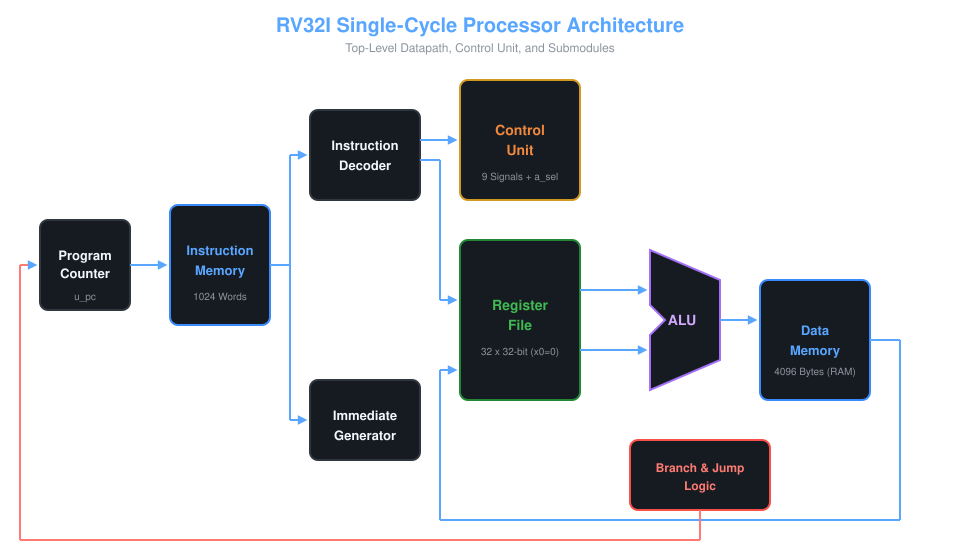
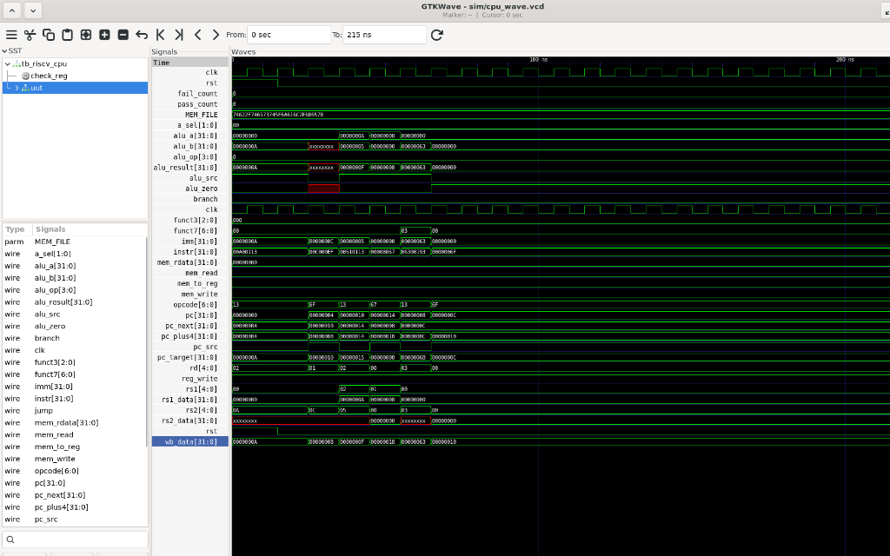

# RV32I RISC-V Single-Cycle Processor: RTL to GDSII

A synthesizable, 32-bit single-cycle RISC-V (RV32I base integer ISA) processor built from scratch in Verilog, functionally verified with Icarus Verilog and GTKWave, and targeted for ASIC synthesis and physical design.

---

## 1. Architecture Datapath

The core implements a Harvard architecture with a single-cycle execution datapath:

- **Word Size:** 32-bit
- **Registers:** 32 general-purpose 32-bit registers (x0 hardwired to 0 on reads and writes)
- **Instruction Formats Supported:** R-type, I-type, S-type, B-type, U-type, J-type
- **ALU Operations:** 10 operations (ADD, SUB, AND, OR, XOR, SLL, SRL, SRA, SLT, SLTU)
- **Memory Subsystem:**
  - Instruction Memory: 1024 words (combinational read)
  - Data Memory: 4096 bytes (Little-Endian, byte/halfword/word access via funct3)
- **Control Flow:** Conditional branching (BEQ, BNE, BLT, BGE, BLTU, BGEU) and unconditional jumps (JAL, JALR)

---

## 2. Verification & Simulation Results

### GTKWave Hardware Simulation Waveform
The waveform below illustrates instruction execution, Program Counter transitions, ALU computation, and register writeback during function calls and subroutine returns (jal and jalr):

### Regression Test Suite (Phase 3 Completed)
All 6 integration test suites run autonomously with self-checking testbenches:

| Test Program | Instruction Categories | Target Behavior Verified | Status |
|---|---|---|:---:|
| `test_addsub.hex` | addi, add, sub | Arithmetic datapath & register writeback | **PASS (5/5)** |
| `test_logic.hex` | and, or, xor, sll, srl, sra | Bitwise gates, barrel shifter, sign preservation | **PASS (11/11)** |
| `test_upper.hex` | lui, auipc | 32-bit constant construction, PC-relative addressing | **PASS (3/3)** |
| `test_mem.hex` | sw, lw, sb, lb, lbu | Little-Endian RAM access, sign/zero byte extensions | **PASS (6/6)** |
| `test_branch.hex` | beq, bne | 5-iteration countdown loop, forward branch skipping | **PASS (5/5)** |
| `test_jal.hex` | jal, jalr | Subroutine call, return via link register ra | **PASS (3/3)** |

**Total Regression Checks: 33/33 Passed.**

---

## 3. How to Build & Simulate

### Prerequisites
- Icarus Verilog (iverilog, vvp)
- GTKWave

### Commands
- Compile and run simulation: `make`
- Open GTKWave waveform viewer: `make wave`
- Clean build artifacts: `make clean`

---

## 4. Architectural Limitations & Scope
- **Single-Cycle Datapath:** Longest combinational path limits maximum clock frequency.
- **Memory Boundaries:** Current simulation memory is 4 KB without MMU/virtual memory.
- **Privileged Architecture:** No CSR registers, exceptions, interrupts, or ECALL/EBREAK implemented.
